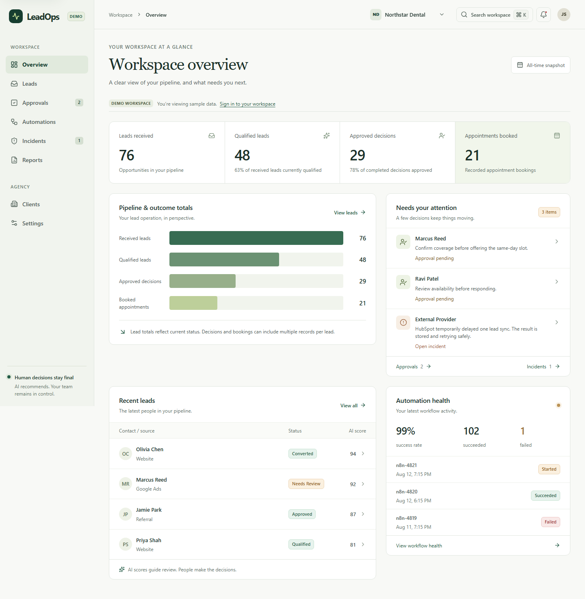
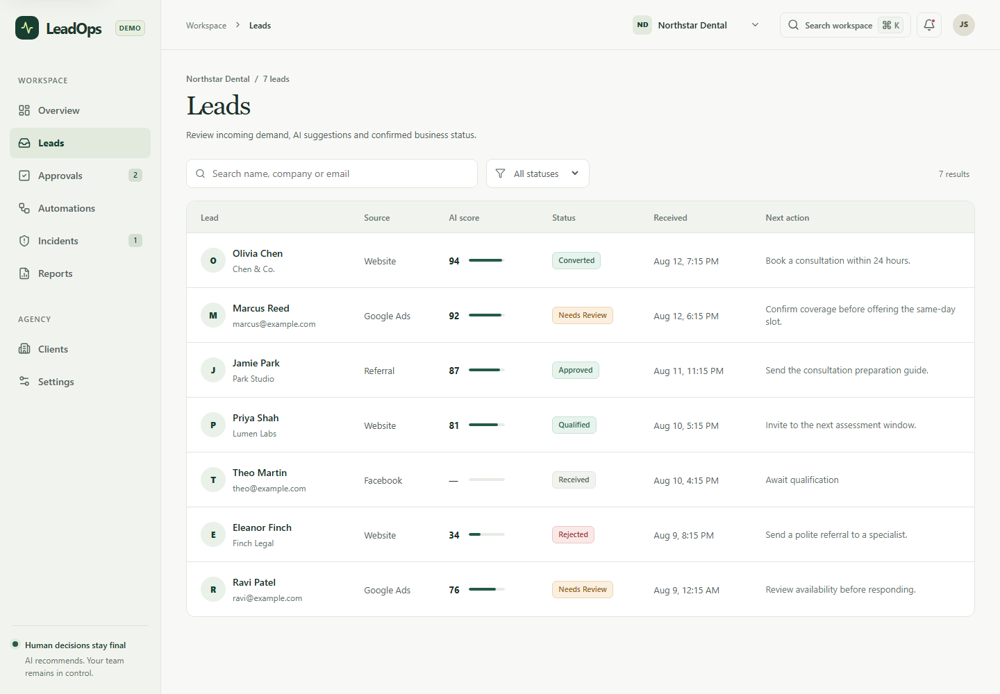
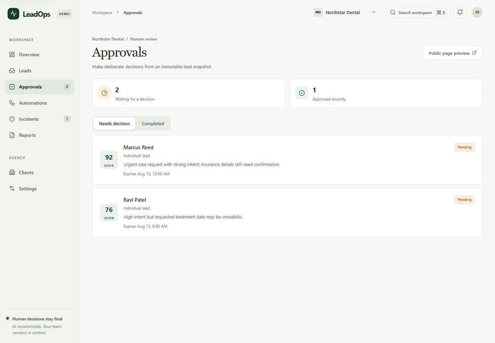
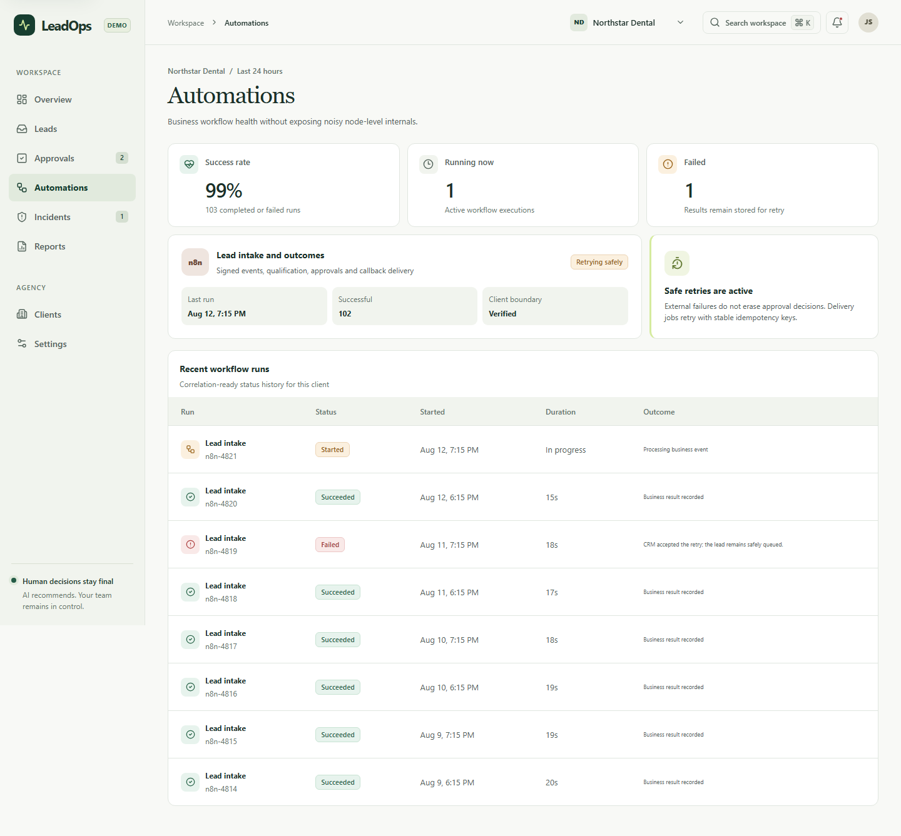
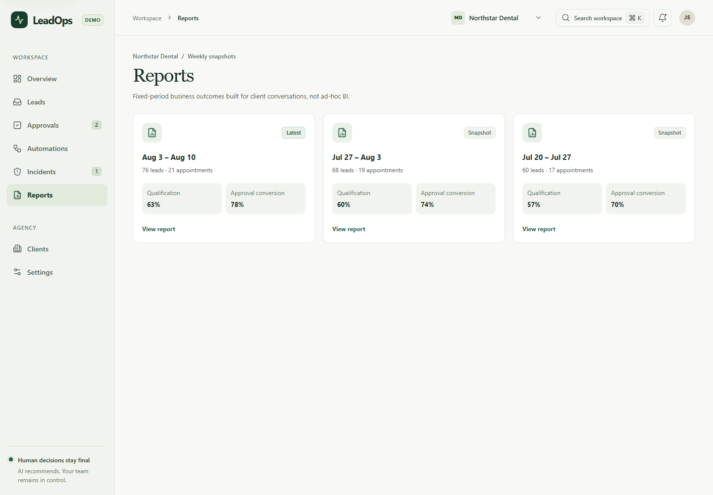
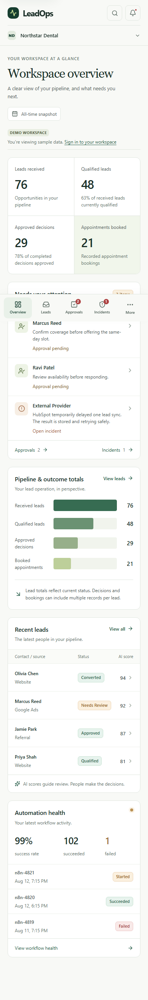

# Frontend redesign — 2026-10-23

LeadOps now uses a calm, light workspace with readable operational text, consistent green actions, and clear separation between metrics, pending decisions, and operational history. The redesign covers all eight product sections, detail views, search, login, and public approval. Screenshots contain synthetic development data.

## Design and behavior

The `frontend-design-explore` workflow compared three working desktop/mobile prototypes: a sidebar workspace, a top-navigation workbench, and a dark lifecycle board. The sidebar workspace was selected under the user's delegated redesign request. [DESIGN.md](../DESIGN.md) records the visual system, responsive rules, and rationale.

- Reworked the overview into a metric strip, an actionable approval/incident queue, pipeline and outcome totals, recent leads, and workflow results.
- Increased business text from the former 8–11px scale, refined list and form spacing, and unified surfaces, borders, controls, and status styling.
- Added mobile access to every permitted section through the More dialog, plus visible search and incident controls.
- Added focus containment, Escape handling, scroll locking, and focus restoration for search, navigation, and approval dialogs, including nested search over an approval drawer.
- Preserved the current section when switching clients, cleared record selections, and remounted the product view so a previous client's detail state cannot remain visible.
- Retained existing API contracts, role restrictions, approval payloads, concurrency fields, and production authentication behavior. No dependencies were added.

The overview uses the backend's qualification and completed-decision rates. Leads, approval records, and appointment events are separate populations; the totals chart does not represent a unique-lead conversion funnel. Its bars scale to the largest displayed count. The all-time view does not invent a seven-day range, trend, or growth rate.

## Validation performed

| Check                            | Result                                                                                                   |
| -------------------------------- | -------------------------------------------------------------------------------------------------------- |
| `pnpm install --frozen-lockfile` | Passed; lockfile unchanged                                                                               |
| `pnpm predev`                    | Shared-package builds passed                                                                             |
| `pnpm lint`                      | Passed with zero warnings                                                                                |
| `pnpm typecheck`                 | Passed across the workspace                                                                              |
| `pnpm test`                      | 33 files, 460 tests passed                                                                               |
| `pnpm build`                     | Passed for all workspace packages and the Next.js production application                                 |
| Browser layout checks            | All 8 sections at 1440, 768, 390, and 320px; 32 checks passed with no document-level horizontal overflow |
| Browser interactions             | 10 groups passed; no browser page or console errors in the final run                                     |

The production build used the repository CI's build-only environment placeholders. Next.js reported the existing OpenTelemetry `require-in-the-middle` dynamic dependency warning; the build completed successfully. This was a build check, not a connection to a production database.

The real Chromium interaction pass covered:

1. Lead filtering, empty results, detail navigation, and return.
2. Ctrl/Cmd+K search, focus containment, Escape, focus return, and destination navigation.
3. Approval drawer keyboard behavior, nested search, and a simulated demo approval.
4. Incident acknowledgement and resolution in demo state.
5. Report snapshot and return navigation.
6. Demo client creation and confirmation that reload does not persist it.
7. Client switching without stale detail state.
8. Mobile More navigation, all eight destinations, focus return, and search.
9. Mobile lead details and approval drawer.
10. Login and public approval at desktop/mobile widths, plus simulated public approval completion.

Database, integration, and backend end-to-end suites were not rerun in this frontend pass. The older full-stack verification snapshot in the README retains its original date and scope.

## Local visual review

```bash
pnpm install --frozen-lockfile
pnpm predev
pnpm --filter @leadops/web dev --hostname 127.0.0.1 --port 3100
```

Open `http://127.0.0.1:3100` in a clean development environment to inspect the existing synthetic demo workspace. Product sections use `?section=overview`, `leads`, `approvals`, `automations`, `incidents`, `reports`, `clients`, or `settings`. Login is at `/login`; the development public-approval fixture is at `/approve/demo-token`.

Production builds continue to enforce the existing authentication and demo restrictions. The redesign does not enable a public production demo or provision infrastructure.

## Screenshots



| Leads                           | Approvals                               |
| ------------------------------- | --------------------------------------- |
|  |  |

| Automations                                 | Reports                             |
| ------------------------------------------- | ----------------------------------- |
|  |  |


